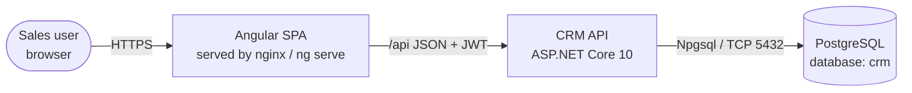
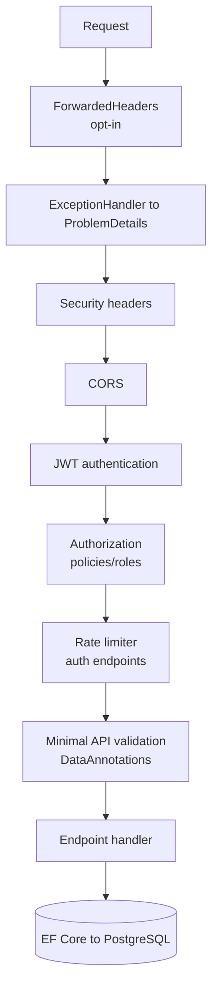
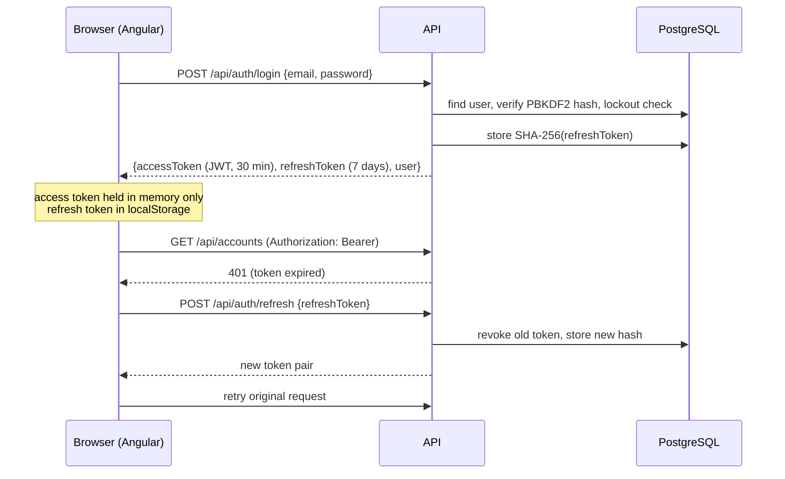

# CRM: Architecture

## 1. System context



- **Web**: static Angular 22 bundle. In development `ng serve` proxies `/api` to the API. In containers nginx serves the bundle and reverse-proxies `/api`, so the browser only ever talks to one origin and no CORS is needed.
- **API**: a stateless REST service. It holds no server-side session, so you can scale it horizontally behind a load balancer.
- **DB**: PostgreSQL. Schema managed by EF Core migrations (`backend/src/Crm.Api/Data/Migrations`), with an idempotent DDL in `backend/database/crm-schema.sql`.

## 2. Repository layout

```
CRM/
├── backend/
│   ├── Crm.slnx
│   ├── Dockerfile
│   ├── database/crm-schema.sql        # idempotent DDL generated from migrations
│   ├── src/Crm.Api/
│   │   ├── Program.cs                 # composition root: DI, middleware, endpoint mapping
│   │   ├── Auth/                      # JWT issuing, refresh-token rotation, /api/auth endpoints
│   │   ├── Common/                    # roles/policies, paging, ownership rules, helpers
│   │   ├── Data/                      # DbContext, entity configs, migrations, seeding
│   │   ├── Domain/                    # entities + enums (pure C#)
│   │   ├── Features/<Feature>/        # vertical slices: DTOs + endpoint handlers per feature
│   │   └── Infrastructure/            # health check, OpenAPI transformer, security headers
│   └── tests/Crm.Api.Tests/           # integration tests (WebApplicationFactory + SQLite in-memory)
├── frontend/
│   ├── Dockerfile, nginx.conf, security-headers.conf, proxy.conf.json
│   └── src/app/
│       ├── core/                      # models, API client, auth service, interceptors/guards, notifications
│       ├── shared/                    # list state, pickers, dialogs, activity panel, pipes
│       ├── layout/shell.ts            # sidenav + toolbar shell
│       └── features/                  # dashboard, accounts, contacts, leads, opportunities, activities, admin, auth
├── docs/                              # PRD, architecture, API, data model, operations, testing, user guide
├── docker-compose.yml, .env.example
└── .github/workflows/ci.yml
```

## 3. Backend design

### 3.1 Style
- **Minimal APIs + vertical slices.** Each feature file (`Features/Accounts/AccountEndpoints.cs`, …) holds its request/response records and handlers. There are no generic repositories: handlers use `CrmDbContext` directly. EF Core already provides the unit of work and repository.
- **Typed results** (`Results<Ok<T>, NotFound, …>`). The OpenAPI document lists every possible response.
- **DTO projection.** Queries use `.Select(...)` straight into records, so no entities are serialized, over-posting is impossible and the SQL is efficient.

### 3.2 Request pipeline



### 3.3 Authorization model
| Layer | Mechanism |
|---|---|
| Endpoint | The `/api` group requires authentication. `ManagerOrAdmin` policy on deletes. `AdminOnly` on user admin. |
| Record | `ClaimsPrincipal.CanModify(ownerId)`: the owner, a Manager or an Admin. Checked in every update/delete handler. |
| Assignment | `Ownership.ValidateAsync`: only managers/admins can assign records to others, and only to active users. |
| UI | `AuthService.canModify()` / `isManager()` / `isAdmin()` hide actions, but the API stays the source of truth. |

### 3.4 Authentication flow



- Refresh tokens are 512-bit random values, stored **hashed**, and **rotated** on every use. If a revoked token is presented, every token for that user is revoked.
- JWT: HS256, issuer/audience validated, 30 s clock skew, `MapInboundClaims = false`, claims `sub`, `email`, `name` and `role`.
- Concurrent 401s in the SPA share a single in-flight refresh (`shareReplay`).

### 3.5 Data access
- `CrmDbContext` extends `IdentityDbContext<AppUser, IdentityRole<Guid>, Guid>`, so Identity and CRM tables share one schema and one transaction.
- Conventions:
  - All `DateTime` values are forced to UTC (`timestamptz`).
  - All `decimal` values use `numeric(18,2)`.
  - Enums are stored as strings, which makes them readable for SQL users and reports.
- Keys are `Guid.CreateVersion7()`. They're time-ordered, which gives good B-tree locality.
- `SaveChangesAsync` stamps `CreatedAt` and `UpdatedAt` using the injected `TimeProvider`, which is testable.
- Delete behaviours: Account→Contacts `SET NULL`, Account→Opportunities `RESTRICT` (the API returns 409), any record→Activities `CASCADE`, Owner FKs `RESTRICT` (users are deactivated, never deleted).

### 3.6 Startup
`DbInitializer` runs one of these strategies:
- `Database:Strategy=Migrate` (default): applies pending migrations.
- `EnsureCreated`: used by tests.
- `None`: use this when DBAs apply `crm-schema.sql` themselves.

It then seeds roles and the initial admin, plus demo data if `Seed:DemoData=true`.

## 4. Frontend design

- **Standalone components only.** Every route is lazy-loaded via `loadComponent`.
- **Zoneless + signals.** State lives in `signal`, `computed` and `linkedSignal`. Server state uses `httpResource`, which is reactive to its signal inputs and supports reload. `stableValue()` keeps the previous page visible while the next loads.
- **Reactive typed forms** in Material dialogs. `EntityPicker` is a `ControlValueAccessor` autocomplete with server-side search for linking records.
- **Interceptors:**
  - `authInterceptor` attaches the bearer token, refreshes once on 401 and retries.
  - `errorInterceptor` shows a snackbar for non-validation errors.
- **Guards:** `authGuard` redirects to `/login?returnUrl=…`, and `roleGuard('Admin')` protects admin routes.
- **Theming:** Material 3 via `mat.theme()`, with CSS system tokens (`--mat-sys-*`). Icons are self-hosted Material Symbols, so the app makes no CDN calls.

## 5. Security controls (OWASP Top 10 mapping)

| Risk | Control |
|---|---|
| A01 Broken access control | Server-side policies, per-record ownership checks, admin-only user management, and tests covering forbidden paths |
| A02 Cryptographic failures | PBKDF2 (Identity v3) password hashes, SHA-256 hashed refresh tokens, JWT signing key ≥ 256 bit from secrets, HTTPS/HSTS in production |
| A03 Injection | EF Core parameterized queries only. No raw SQL. |
| A04 Insecure design | Lockout, rate limiting, refresh-token reuse detection, converted leads immutable, can't delete an account with deals |
| A05 Security misconfiguration | Secrets in user-secrets or environment only. OpenAPI UI enabled in Development only by default. Security headers and CSP. Non-root containers. |
| A07 Identification and authentication failures | Strong password policy, lockout, short-lived access tokens, server-side logout |
| A08 Software and data integrity | Lockfiles (`package-lock.json`), CI builds from source, pinned major versions |
| A09 Logging and monitoring | ASP.NET Core logging, health endpoints, ProblemDetails with trace IDs |
| A10 SSRF | The API makes no outbound calls based on user input |

Residual risk: the refresh token is stored in `localStorage`, so XSS could steal it. Mitigations are a strict CSP, Angular's built-in output encoding, and token rotation with reuse detection. A future hardening option is to move the refresh token into an `HttpOnly; Secure; SameSite=Strict` cookie.

## 6. Key decisions (ADR summary)

| # | Decision | Alternatives considered |
|---|---|---|
| ADR-1 | Single deployable API project with vertical slices | Clean Architecture with 4 projects: more ceremony than this domain needs |
| ADR-2 | JWT + rotating refresh tokens | Cookie auth (needs CSRF handling, harder with separate origins), external IdP (not available yet) |
| ADR-3 | Integration tests on SQLite in-memory | Testcontainers PostgreSQL (needs Docker, which isn't available on dev laptops). CI can add a PostgreSQL job later. |
| ADR-4 | Enums stored as strings | ints: smaller, but opaque to report writers |
| ADR-5 | `httpResource` for reads, `HttpClient` for writes | NgRx: unnecessary for this app's state complexity |
