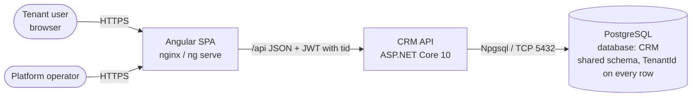
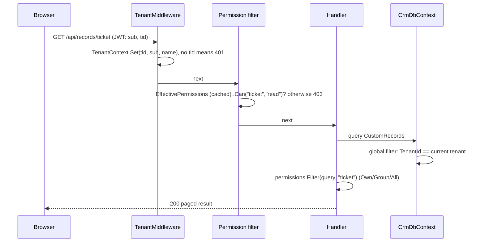
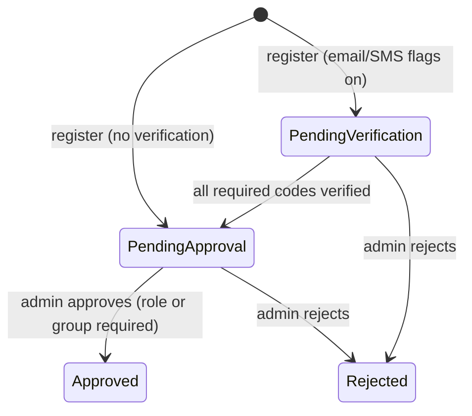
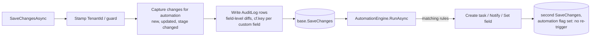
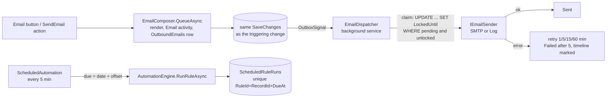

# CRM Platform: Architecture

## 1. System context



- **Web:** a static Angular 22 bundle. In development `ng serve` proxies `/api` to the API. In containers, nginx serves the bundle and reverse-proxies `/api`, so there's one origin and no CORS.
- **API:** stateless REST. Tenant and user come from the JWT on every request. It scales horizontally.
- **DB:** one PostgreSQL database with a shared schema. Every tenant-owned table has a `TenantId` column. Schema is managed by EF Core migrations, and the idempotent DDL is in `backend/database/crm-schema.sql`.

## 2. Repository layout

```
CRM/
├── backend/
│   ├── database/crm-schema.sql        # idempotent DDL generated from migrations
│   ├── src/Crm.Api/
│   │   ├── Program.cs                 # composition root: DI, middleware, endpoint groups
│   │   ├── Auth/                      # JWT + refresh tokens, /api/auth, UserInfo (permissions, tenant)
│   │   ├── Automation/                # AutomationEngine: rule evaluation and actions
│   │   ├── Common/                    # TenantContext + TenantMiddleware, paging, errors, custom-field JSON helpers
│   │   ├── Data/                      # CrmDbContext (tenant filters, audit, automation hook), configs, migrations, seeding
│   │   ├── Domain/                    # entities and enums
│   │   ├── Features/<Feature>/        # vertical slices: accounts, contacts, leads, opportunities, activities,
│   │   │                              #   records (custom objects), dashboard, users, security (roles/groups),
│   │   │                              #   customization (metadata, objects, fields, stages, picklists, automation),
│   │   │                              #   governance (audit, settings, notifications)
│   │   ├── Metadata/                  # MetadataService, CustomFieldValidator, JSONB custom-field filters
│   │   ├── Platform/                  # tenant templates, TenantService, /api/platform endpoints
│   │   └── Security/                  # RoleGrants, EffectivePermissions, PermissionService, endpoint filters
│   └── tests/Crm.Api.Tests/           # integration tests (WebApplicationFactory + SQLite in-memory)
├── frontend/src/app/
│   ├── core/                          # models, API client, AuthService (permissions), MetadataService, guards
│   ├── shared/                        # custom-field editor/view/filters, stage chip/path/board, record history,
│   │                                  #   entity picker, owner field, activity panel, list state
│   ├── layout/shell.ts                # dynamic navigation, notifications bell, user menu
│   └── features/                      # dashboard, accounts, contacts, leads, opportunities, activities,
│                                      #   records (generic custom objects), admin (settings hub), platform (tenants)
├── scripts/                           # start-dev.ps1, smoke-test.ps1, backup-db.ps1
└── docs/
```

## 3. Multi-tenancy

### 3.1 Model
**Shared database, shared schema, `TenantId` discriminator** (ADR-6). A `Tenants` table holds the name, slug, status (Active/Suspended), currency and template. Every business and configuration entity implements `ITenantEntity`. Users (`AspNetUsers`) carry `TenantId` too, and emails are unique platform-wide so sign-in needs no tenant selector.

### 3.2 Request flow



### 3.3 Enforcement layers
| Layer | Mechanism |
|---|---|
| Token | `tid` claim issued at sign-in. `TenantMiddleware` rejects authenticated requests without it. |
| Reads | EF Core **global query filters** on every `ITenantEntity`, built once per model with `CurrentTenantId` read from the context instance, so handlers can't forget them. |
| Writes | `SaveChangesAsync` stamps `TenantId` on new rows and **throws** if a new row names another tenant, or if a modified row's `TenantId` changes (it compares original with current values, because ASP.NET Identity marks every property as modified). |
| Suspension | Sign-in returns 403. `EffectivePermissions.TenantActive = false` resolves every scope to None, so existing tokens stop working immediately. |
| Platform | `/api/platform/*` requires `IsPlatformAdmin` on an active tenant. Background work uses `TenantContext.Use(tenantId)` for explicit, temporary scopes (provisioning, seeding). |
| Lifecycle | `TenantService.CreateAsync` provisions in a transaction (tenant, template, admin user, optional demo data). `DeleteAsync` removes children in dependency order with `ExecuteDelete`. |
| Anonymous (self-registration) | No token, so no tenant context and no query filters. `RegistrationService` resolves the tenant explicitly from the organisation code (active and opted in), and uses `TenantContext.Use(user.TenantId)` when it touches tenant data (roles, notifications). |

### 3.4 Self-registration



- **Two gates:** the global `PlatformSettings.SelfRegistrationEnabled` (platform admin) and `Tenant.SelfRegistrationEnabled` (organisation admin). Verification flags are global so the delivery providers are configured once.
- **Settings:** `PlatformSettingsService` stores `PlatformSettings` as key/value rows in `AppSettings`, cached for one minute and invalidated on save. `Validate()` covers cross-field rules (SMTP host and sender, absolute gateway URL).
- **Delivery:** `IEmailSender` and `ISmsSender` pick the provider from the settings on each call: *Log* (API log; the body, including the code, only in Development), *SMTP* (`System.Net.Mail`, password from `Email:SmtpPassword`) or *HTTP gateway* (named `HttpClient`, 15 s timeout, key from `Sms:ApiKey`). Send failures are logged and don't fail the request; the user can resend.
- **Codes:** random digits from `RandomNumberGenerator`, stored as SHA-256 of `userId:channel:code`, compared in fixed time, single use, limited attempts, expiry and resend cooldown. Issuing a new code replaces the old one.
- **Sign-in:** the password is checked first, so the registration state is only revealed to someone who knows it. Non-approved users get 403 with `registrationStatus` and the channels still to verify. If an admin has since switched verification off, a pending user moves on to approval at sign-in.
- **Approval:** reuses the user-admin escalation check. Approvers are notified (in-app) when a request reaches PendingApproval; the approved user gets an email.

## 4. Authorization (RBAC)

### 4.1 Model
```
Role (per tenant) ── RolePermission (Resource, Action, Scope)
 │                     Resource: object key | "*" | users | groups | roles | customization | settings | audit
 │                     Action:   read | create | update | delete | manage
 │                     Scope:    None | Own | Group | All
 ├── UserRole ──── User
 └── GroupRole ─── Group ── GroupMember ── User
```

### 4.2 Resolution
1. **Per role:** an explicit `(resource, action)` grant wins, **including None** (deny). Otherwise the role's `("*", action)` grant applies. `*` never applies to admin resources.
2. **Across roles:** the user's roles are those assigned directly plus those inherited from their groups. The effective scope is the **widest** across all of them.
3. **Administrator** roles short-circuit to All. A suspended tenant or inactive user short-circuits to None.
4. **Group scope:** `TeamUserIds` is the user plus every member of every group they belong to. Group access means `OwnerId ∈ TeamUserIds`.

`EffectivePermissions` is cached per user in `IMemoryCache` for 5 minutes. Any role, group, membership or user change cancels the tenant's `CancellationTokenSource`, which invalidates every cached entry for that tenant at once.

### 4.3 Enforcement
| Where | How |
|---|---|
| Endpoint | `RequirePermission(resource, action)`, `RequireAnyPermission`, `RequirePlatformAdmin` endpoint filters return 403 when the action isn't granted at any scope. |
| Query | `permissions.Filter(query, resource, action)` adds `WHERE OwnerId = me`, `OwnerId IN (team)` or nothing. |
| Record | `CanAccess(resource, action, ownerId)` for get, update and delete. Hidden records return 404, not 403, so they don't leak existence. |
| Assignment | `Ownership.ValidateAsync`: the new owner must be within the caller's update scope and active in the tenant. |
| Escalation | `Covers(roles)` compares **resolved** scopes, over `*` plus every resource either side mentions, so a role like `*: All` can't slip past an explicit deny the caller has. Only administrators can grant the Administrator role. |
| UI | `/api/auth/me` returns resolved scopes for `*` and each mentioned resource. `AuthService.scope/can/canModify/canDelete/canAssign` hide navigation, buttons and owner pickers. Route guards: `objectGuard`, `permissionGuard`, `adminAreaGuard`, `platformGuard`. |

## 5. Metadata and custom data

| Concept | Storage | Notes |
|---|---|---|
| Object | `ObjectDefinitions` | Standard objects (`account`, `contact`, `lead`, `opportunity`, `activity`) and custom ones. Label, plural, icon, name label, pipeline flag, active flag, order. |
| Field | `FieldDefinitions` | 13 types. Values live in the record's **`CustomFields jsonb`** column, keyed by field key. |
| Stage | `PipelineStages` | Per object: key, label, category (Open/Won/Lost), probability, colour, order. |
| Picklist | `Picklists` | `account.industry` and `lead.source` (JSON arrays). |
| Custom record | `CustomRecords` | One table for all custom objects: `ObjectDefinitionId`, `Name`, `Stage`, `ClosedAt`, `CustomFields`, owner. |

- `MetadataService` caches the tenant's definitions for each request. The UI loads them once via `GET /api/metadata` (the `metadataGuard` runs before any page renders).
- `CustomFieldValidator` merges incoming values with stored ones, then validates type, required, range, length, options and lookup existence (in the same tenant). It normalises numbers and returns field-keyed validation errors.
- **Unique fields** (`FieldDefinitions.IsUnique`) are checked by the same validator with a JSONB containment query on the object's records, excluding the record being saved. Values the record already had are not re-checked, so old duplicates don't block unrelated edits. The CSV import also checks for duplicates within the file. This is an application-level check: two simultaneous saves of the same new value could both succeed. That is acceptable for recruitment data entry; a unique expression index per field would close it if needed.
- **Template versions.** Each tenant stores the `TemplateVersion` it was provisioned or upgraded with. At startup `TenantTemplates.UpgradeTenantsAsync` re-applies the template to tenants whose version is behind `CurrentVersion(template)`, then records the new version. Applying a template only **adds** missing objects, fields, stages and rules; it never changes or deletes existing configuration or records. Because each version is applied once, anything an admin later removes stays removed.
- **Filtering:** `?cf.priority=High` becomes `CustomFields @> '{"priority":"High"}'` through `EF.Functions.JsonContains` on PostgreSQL, which can use a GIN index. SQLite, in tests only, falls back to substring matching.
- Opportunity `Stage` is a string key into the tenant's stages. "Open" means `ClosedAt IS NULL`, set from the stage category.

## 6. Automation, audit and notifications



- Rules are loaded per tenant and object. Conditions compare against a flattened field dictionary: standard properties via reflection, plus `cf.key` entries. `Changed` compares with the original values.
- Templates render `{{field}}` placeholders. `AssignTo` is `owner` or a user id in the same tenant; anything else falls back to the owner.
- Audit entries record user id and name (or "Automation"/"System"), entity type (object key), entity id and name, action, and a JSON map `{ field: [old, new] }`.
- Notifications are rows per user with a link to the record's route. The shell polls every 60 s.

### 6.1 Email outbox and date-based rules



- **Transactional outbox.** An email is a row saved in the same transaction as the record change (or the user's send), so an email is never sent for a change that rolled back, and nothing is lost if SMTP is down. Sending happens outside the request.
- **Several API instances.** The dispatcher claims each email with a conditional update (`LockedUntil`, 5-minute lease) and only sends what it claimed. A crash mid-send leaves the lease to expire and the email is retried: delivery is *at least once*. Scheduled rules record each run in `ScheduledRuleRuns` with a unique key in the same transaction as their actions, so a second instance's attempt fails and rolls back.
- **Abuse limits.** Users can only email addresses held on the record (or its linked records), need update access to it, and are rate limited. Each tenant has a daily cap (`Email:DailyLimitPerTenant`). A rule emails the same person about the same record at most once a day, so "is updated" rules can't flood.
- **Rendering.** `EmailComposer.ContextAsync` builds placeholder values once per record: formatted custom fields, lookups resolved to names, one level of linked-record fields, owner, organisation and a link. For user-initiated emails, linked records the user can't read stay blank. Emails are plain text, so record data can't inject markup.
- **Date rules** compare custom date fields in memory (they live in JSON); `createdAt`/`updatedAt` are filtered in SQL. Each run scans at most 20,000 records per rule.

### 6.2 Careers page and export

- **Anonymous entry into a tenant.** `/api/careers/{slug}` resolves an active tenant with the careers page on, then sets the request's `TenantContext` (user name *Careers site*, no user id). From there the normal global filters, save guard, audit and automation apply, so the public endpoints can only reach that tenant's published job openings and can only *add* candidates, applications, notes and files.
- **No overwrite, no enumeration.** A known email links the new application to the existing candidate without changing them; the submitted details go into a note. New, repeated and honeypot submissions get identical 202 responses.
- **Upload checks.** Allow-listed extensions, a size limit and a file-signature check (`%PDF`, ZIP for docx/odt, OLE for doc, `{\rtf`), on top of the attachment rules (server-chosen storage keys, server-set content types, downloads never inline).
- **Abuse limits.** Per-IP rate limits for reading and applying, a honeypot field and server-side validation. A CAPTCHA isn't included because the platform makes no outbound calls to third parties; it can be added in front of `apply` if spam appears.
- **Export** builds one query per object from the caller's read scope plus the list filters (custom-field filters, standard-field equality built from the entity's properties, search, owner, stage/open, activity status). It resolves linked-record names in one query per object, honours read scope for those names too, writes RFC 4180 CSV with formula-injection protection, and audits the export.

### 6.3 Interviews and hiring analytics

- **Typed tables, not custom objects.** Interviews, participants and scorecards are fixed entities (`Features/Interviews`) linked to the *application* custom record, because they carry behaviour (calendar entries, notifications, blind visibility) that metadata can't express. They follow the usual rules: `ITenantEntity`, global filters, audit and cascade delete with their application.
- **Calendars through activities.** Each interviewer gets a *Meeting* activity (id kept on the participant row), so interviews appear in existing activity lists, the dashboard and overdue filters with no new calendar UI. The interview owns those activities: rescheduling moves them, removing an interviewer or cancelling deletes them, a submitted scorecard completes them. A `.ics` download covers external calendars without outbound calls.
- **One source for the next interview date.** After every change the application's `interview_date` is set to the next scheduled future interview (or cleared), so the existing *Interview reminder* date rule and the email placeholders keep working unchanged.
- **Blind scorecards on the server.** `ToItemsAsync` decides per caller which scorecards to return; the UI never receives colleagues' feedback before the interviewer has submitted, so it can't be read from the network tab.
- **Analytics from the audit log.** Stage history comes from `Updated` audit rows with a `stage` change, read in chunks of 1,000 ids, so the funnel needs no extra tracking table and covers history from before Phase 4. Applications are filtered by the caller's read scope first; the period applies to creation date, and at most 20,000 applications are analysed per request.

### 6.4 Offers and candidate privacy

- **Capability links.** The candidate answers an offer through `/offer/<token>`: 32 random bytes, Base64Url. Only the SHA-256 hash is stored (unique index), like password-reset and refresh tokens. The anonymous endpoints look the hash up across tenants, check the tenant is active, then set `TenantContext` (user *Candidate*), so normal filters, save guard and audit apply. Sending again or withdrawing replaces or clears the hash, so old links stop working. Links are built from `App:PublicUrl`, never from the request.
- **Keeping the link private.** The outbox row holds the real link (it must be emailed), but the Email activity on the application, readable by anyone who can read the record, gets a copy with `[link sent to the candidate]` (`QueueEmail.TimelineBody`). `TokenHash` is excluded from the audit log.
- **Electronic acceptance.** The candidate types their full name (compared with the application's name, ignoring case and spacing) and ticks a confirmation; the server stores the typed name, time, IP and user agent, and adds a timeline note. This is a simple electronic signature; qualified signatures (DocuSign) are on the backlog.
- **One open offer per application** is a filtered unique index (`Status IN ('Draft','Sent')`), so two concurrent "make offer" requests can't both succeed; the losing request gets a 400. Expiry is evaluated when offers are read or answered (no background job), and analytics treats overdue *Sent* offers as expired.
- **Letters** are ordinary email templates with offer placeholders, so the template editor, placeholder validation and rendering are reused. The letter is frozen when first sent, so later template edits don't change what the candidate signed.
- **Erasure** runs in one transaction: bulk-delete emails and notifications, delete activities, applications and the candidate through EF (attachments and stored files follow, and interviews, scorecards and offers cascade in the database), blank `EntityName`/`Changes` on every audit row for the collected ids, then add one anonymous `Erased` row. Retention erases eligible candidates one transaction at a time, at most 100 per run.
- **Subject access export** streams `data.json` and the stored files into a ZIP. Interviewers are replaced with "Interviewer 1, 2…" to protect colleagues' identities while giving the candidate the substance of the feedback.

### 6.5 Mock interviews and AI feedback

- **Library as metadata.** Practice questions are records of the template object `mock_question`, so lists, forms, import, export, permissions and audit come for free. A job-specific question links to a job opening; blank means every job.
- **Snapshot, not reference.** Inviting copies the chosen questions (with short ids `q1`, `q2`…) into `MockInterviews.Questions`, and answers live in `Answers` (both jsonb). Library edits never change a session in progress, and no internal ids reach the candidate. `Questions`, `Answers` and `AiFeedback` are excluded from the audit log (bulky personal data); status, review and AI state changes are audited.
- **Same link model as offers** (§6.4): hashed 256-bit token, active tenants only, `Candidate` actor, separate rate limit (60/min, as answers are saved per question), one open session per application through a filtered unique index (`Status IN ('Sent','InProgress')`), lazy expiry. Tips are returned only for answered questions, and nothing the hiring team writes is ever in the public payload.
- **AI review pipeline.** Requesting feedback (or submission, if the organisation chose automatic) sets `AiStatus = Pending`. `MockAiReviewService` polls only while `Ai:Enabled` is true; `MockAiReviewProcessor` leases each session (`AiLockedUntil`, safe on several instances), resolves the connection, calls `IMockInterviewReviewer`, validates the reply and notifies the sender. `ChatCompletionsReviewer` speaks OpenAI and Azure OpenAI Chat Completions with JSON output, per-attempt timeouts, and retries with exponential backoff (honouring `Retry-After`) for 408, 429, 5xx, timeouts and unparseable replies.
- **Prompt design.** A short rule-based system prompt with a fixed JSON reply shape; candidate input is sent as compact JSON data (answers clipped to 3,000 characters, model answers to 1,500) and the prompt tells the model to ignore instructions inside answers. The organisation's guidance is appended but can't change the rules or format. Replies are validated: unknown question ids dropped, scores clamped to 1–5, text trimmed. No names, emails or ids are sent.
- **Configuration split.** Server: `Ai:Enabled` (kill switch) and `Ai:Keys:<name>` (secret). Platform settings: provider, HTTPS endpoint, model/deployment, API version, key *name*, timeout, retries, output tokens, temperature. Organisation: opt-in, trigger and guidance. Organisations can't point the platform at their own endpoints (no SSRF).

### 6.6 Theming

- One Material 3 theme with `theme-type: color-scheme`: every Material token and the app's semantic tokens (`--crm-success`, `--crm-warning`, `--crm-info`, `--crm-ai-surface`…) use CSS `light-dark()`, and `ThemeService` only toggles `color-scheme` on `<html>`. No duplicated stylesheets, and components never hard-code colours.
- The preference (System/Light/Dark) is a `linkedSignal` seeded from the signed-in user (`UserInfo.theme`), falling back to the device's saved choice, so public pages and the sign-in screen open in the right theme; changes are saved with `PUT /api/auth/me/preferences`.

## 7. Frontend design

- **Metadata-driven UI.** `MetadataService` exposes labels, icons, fields, stages, picklists and currency as signals. Navigation, list columns, filters, forms, detail views, stage paths and boards are all generated from it.
- **Generic record screens.** `/o/:objectKey` (list), `/o/:objectKey/board` and `/o/:objectKey/:id` serve every custom object with no per-object code.
- **Shared building blocks:**
  - `CustomFieldsEditor`, `customFieldsGroup` and `customFieldsValue` build typed reactive-form controls and convert them to and from the API format.
  - `CfValue`, `CustomFieldsView` and `CfFilters` display custom fields and provide list filters.
  - `StageChip`, `StagePath` and `StageBoard` (CDK drag-drop, optimistic) show and change stages.
  - `RecordHistory` (lazy-loaded audit) shows each record's change history.
  - `RelatedRecords` finds every readable object with a lookup to the current object and shows a related list per lookup (latest 10, with View all, Pipeline and a prefilled New). It appears on account, contact and custom-record detail pages.
  - Lists and boards accept `?cf.<field>=` deep links. `CfFilters` shows a record picker for lookup fields, so a board can be narrowed to one job or one candidate. New records created from a filtered board or a related list inherit the filter values, and a record whose name label refers to a lookup ("Candidate name") takes its name from the chosen record.
- **Settings hub** (`/settings/*`) and **platform** (`/platform/tenants`) are lazy-loaded and guarded by permission.
- **Zoneless + signals, `httpResource`** for reads and `HttpClient` for writes. Interceptors attach the JWT, refresh once on 401 and surface errors as snackbars.
- **Token refresh across tabs:** all tabs share the refresh token in `localStorage`. Rotation runs under a Web Locks (`navigator.locks`) lock and reads the latest stored token inside it, so two tabs never present the same token. The server would treat that as reuse and revoke the session.

## 8. Security controls (OWASP Top 10)

| Risk | Control |
|---|---|
| A01 Broken access control | Tenant query filters and a write guard. Per-endpoint permission filters. Per-record scope checks, with 404 for hidden records. Anti-escalation on resolved scopes. Administrator role protected. Tests for isolation, group scope, deny override and escalation. |
| A02 Cryptographic failures | PBKDF2 password hashes, SHA-256 hashed refresh tokens, a ≥ 256-bit JWT key from secrets, HTTPS/HSTS in production |
| A03 Injection | EF Core parameterised queries only. The JSONB filter value is serialised with `System.Text.Json` and passed as a parameter. Object, field and stage keys are validated against strict regexes. Export filters on standard fields are built as typed expressions from known properties. CSV exports neutralise spreadsheet formulas. |
| A04 Insecure design | Lockout, rate limits (including separate self-registration and careers policies), token reuse detection, automation loop guard, stage and object deletion blocked while in use, tenant deletion only when suspended. Self-registered users start inactive with no roles and need admin approval. Anonymous careers applications can only add records, never change existing ones. Offer links are single-purpose, hashed, replaceable and rate-limited; erasure needs the candidate's name typed. |
| A05 Misconfiguration | Secrets in user-secrets or environment only (including the SMTP password and SMS API key, which the API never stores or returns). OpenAPI UI only in Development by default. CSP and security headers. |
| A07 Authentication failures | Strong password policy, lockout, short-lived tokens, server-side logout, suspended-tenant sign-in blocked. Self-registration: hashed single-use codes with attempt limits and expiry, and no account enumeration (identical responses for existing and unknown emails). |
| A08 Integrity | Lockfiles and CI builds from source |
| A09 Logging | Audit log for business data. Tenant lifecycle is logged. ProblemDetails responses carry trace IDs. |
| A10 SSRF | The only outbound calls are SMTP, the SMS gateway and Sentry, to hosts that only platform admins or operators configure (absolute http(s) URL, validated). Users can't influence the destination. Automation has no webhook action, and user-sent emails can only go to addresses already on the record. |

Residual risks:
- The refresh token lives in `localStorage` (mitigated by CSP, rotation and reuse detection).
- Isolation relies on the application layer. PostgreSQL row-level security would add defence in depth (ADR-6).
- A platform admin can point the SMS gateway at any URL, and the API key is sent there. Treat platform admin as a highly trusted role, and consider an egress allow-list in production.

## 9. Key decisions (ADR summary)

| # | Decision | Alternatives |
|---|---|---|
| ADR-1 | Single API project with vertical slices | Multi-project Clean Architecture: more ceremony than needed |
| ADR-2 | JWT with rotating refresh tokens | Cookie auth (CSRF handling), external IdP (not yet available) |
| ADR-3 | Integration tests on SQLite in-memory, plus a live smoke test on PostgreSQL | Testcontainers (no Docker on dev laptops) |
| ADR-6 | **Shared schema + `TenantId`** with EF global filters and a save guard | Schema-per-tenant or DB-per-tenant: stronger isolation but heavy migration fan-out, and connection pools per tenant. Can be added later for regulated tenants. Postgres RLS is a candidate hardening step. |
| ADR-7 | **Custom fields in `jsonb`** on each record, plus a single `CustomRecords` table | EAV tables (slow, complex queries), DDL per custom field (migrations at runtime, lock risk) |
| ADR-8 | **Own RBAC tables** (roles, grants, groups) instead of Identity roles/claims | Identity roles: no scopes, no per-tenant roles, no groups |
| ADR-9 | **Per-role override, union across roles** | Pure union including `*` (can't restrict an object below the default) or deny-wins across roles (one restrictive role silently removes access granted by another) |
| ADR-10 | Automation runs in-process after `SaveChanges` | A queue/outbox: more robust at scale, but more infrastructure. The outbox is the planned next step for email/webhook actions. |
| ADR-11 | Metadata loaded once per session in the SPA, reloaded after customization | Per-page fetches: more requests, flicker |
| ADR-12 | **Self-registration gated twice** (platform + organisation). Verification flags and providers are **global platform settings stored in the database** and edited in the UI; secrets stay in configuration. The tenant slug is the organisation code. | Per-tenant providers (duplicated SMTP/SMS setup per organisation); flags in `appsettings` (needs a redeploy to change); a separate invitation-code table (more admin work for the same outcome) |
| ADR-13 | **Attachments behind `IFileStorage`**, local/shared disk first; server-generated storage keys; one generic table keyed by `(ObjectKey, RecordId)` | Bytes in PostgreSQL (`bytea`: bloats backups and the DB); cloud SDK from day one (no outbound access from dev machines yet) |
| ADR-14 | **Own password-reset tokens** (hashed, single use, in the DB) instead of Identity's data-protection tokens | Identity tokens need a shared data-protection key ring across nodes and can't be revoked individually |
| ADR-15 | **CSV import validates everything, then saves in one transaction** (all-or-nothing, automation off) | Row-by-row partial imports (leave half-loaded data to clean up); background jobs (unneeded at 5,000 rows) |
| ADR-16 | **Versioned, additive template upgrades** applied once per tenant at startup | Re-applying templates on every start (would resurrect fields admins deleted); manual per-tenant migration scripts (error-prone across many tenants); destructive upgrades (risk to customer data) |
| ADR-17 | **Applications as a separate object** linking candidate × job, rather than stages on the candidate | Candidate-only pipeline: one candidate can't be in several jobs' pipelines at once, and the history per job is lost |
| ADR-18 | **Transactional outbox in PostgreSQL** with an in-process dispatcher and lease-based claiming | Sending inside the request (slow, lost on SMTP errors, sent even if the transaction rolls back); a message broker (more infrastructure than needed today) |
| ADR-19 | **Polling scheduler with a unique run key** for date-based rules | Per-record scheduled jobs (must be rescheduled whenever a date changes); Quartz/Hangfire (extra dependency and tables for one feature) |
| ADR-20 | **Recipients limited to the record's own addresses** for user-sent email | Free-text recipients (turns the CRM into an open relay for any signed-in user) |
| ADR-21 | **Careers endpoints in the main API**, entering the tenant by slug, and **append-only** for anonymous callers | A separate public service (more deployment for the same data); updating existing candidates from the form (lets anyone change a candidate's details by knowing their email) |
| ADR-22 | **Export uses read permission plus an audit entry**, not a separate export permission | A new "export" action in every role (more admin work; anyone who can read a list can already copy it). Can be added later if customers ask. |
| ADR-23 | **Interviews as typed entities** linked to the application, with interviewer calendars as ordinary *Meeting* activities | Interviews as a custom object (no participants, blind feedback or calendar sync logic); a separate calendar model and UI (duplicates activities) |
| ADR-24 | **Blind feedback enforced in the API** (scorecards filtered per caller) | Hiding in the UI only (leaks through the network tab); hiding from everyone until the interview is complete (managers can't follow progress) |
| ADR-25 | **Funnel computed from the audit log** on request | A stage-history table (extra writes on every change and no history for existing data); a nightly aggregate (stale, more infrastructure). Revisit if tenants exceed 20,000 applications per period. |
| ADR-26 | **Offer acceptance through a hashed capability link** with a typed-name signature | Candidate accounts (sign-up friction for a one-off decision); a third-party e-signature service (outbound calls, cost; kept for the backlog) |
| ADR-27 | **Erasure deletes and anonymises in place**, keeping an anonymous audit trail | Soft delete (data still held, so not erasure); deleting audit rows (loses the record that changes and the erasure happened) |
| ADR-28 | **Retention is previewed and run by an administrator**, not on a timer | Automatic scheduled deletion (an irreversible mistake affects many people at once; can be added once customers trust the preview) |
| ADR-29 | **Mock interview questions snapshotted into the session as JSON** | A join table to library records (library edits would change sessions in flight; internal ids exposed to candidates); a separate answers table (one write per answer either way, more joins) |
| ADR-30 | **AI provider configured per platform with three switches** (server, platform connection, organisation opt-in); keys only in server configuration | Per-organisation endpoints and keys (SSRF risk, secrets in the database); a single on/off flag (no way for one organisation to decline) |
| ADR-31 | **AI review runs in the background with a lease**, never in the request | Calling the model while the recruiter waits (slow, ties up request threads, no retry); a message broker (more infrastructure for low volume) |
| ADR-32 | **Dark mode through `light-dark()` tokens and `color-scheme`** | Two compiled themes swapped by class (double CSS, drift between them); per-component dark overrides (easy to miss) |
