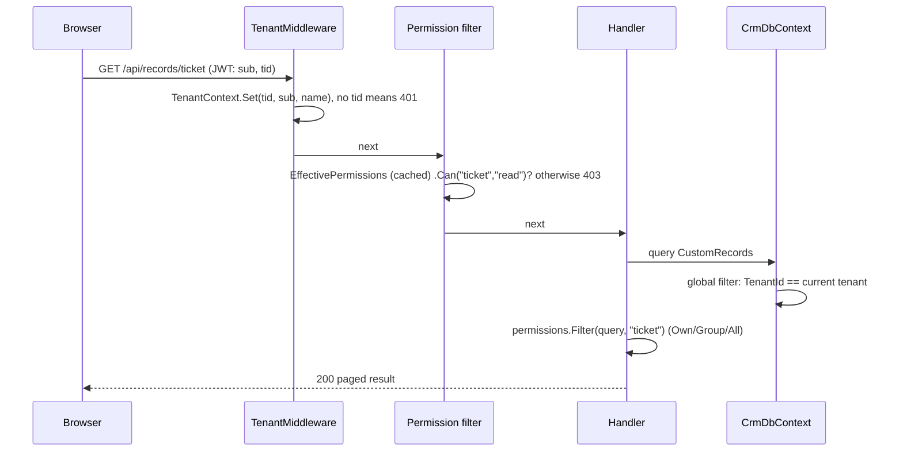
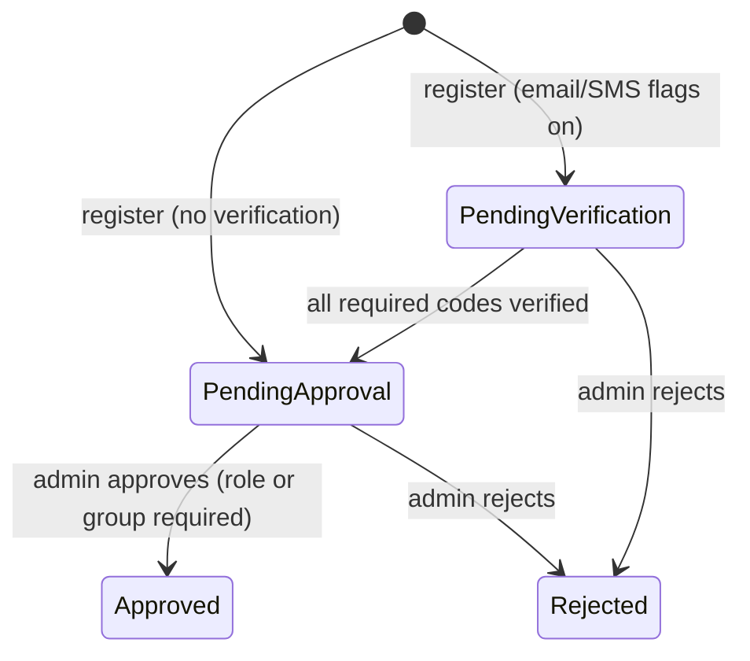
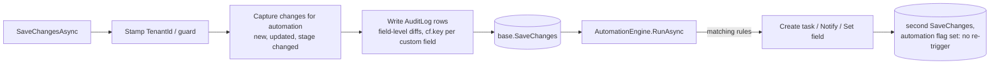

# CRM Platform: Architecture

## 1. System context


- **Web:** a static Angular 22 bundle. In development `ng serve` proxies `/api` to the API. In containers, nginx serves the bundle and reverse-proxies `/api`, so there's one origin and no CORS.
- **API:** stateless REST. Tenant and user come from the JWT on every request. It scales horizontally.
- **DB:** one PostgreSQL database with a shared schema. Every tenant-owned table has a `TenantId` column. Schema is managed by EF Core migrations, and the idempotent DDL is in `backend/database/crm-schema.sql`.

## 2. Repository layout

```
CRM/
├── backend/
│   ├── database/crm-schema.sql        # idempotent DDL generated from migrations
│   ├── src/Crm.Api/
│   │   ├── Program.cs                 # composition root: DI, middleware, endpoint groups
│   │   ├── Auth/                      # JWT + refresh tokens, /api/auth, UserInfo (permissions, tenant)
│   │   ├── Automation/                # AutomationEngine: rule evaluation and actions
│   │   ├── Common/                    # TenantContext + TenantMiddleware, paging, errors, custom-field JSON helpers
│   │   ├── Data/                      # CrmDbContext (tenant filters, audit, automation hook), configs, migrations, seeding
│   │   ├── Domain/                    # entities and enums
│   │   ├── Features/<Feature>/        # vertical slices: accounts, contacts, leads, opportunities, activities,
│   │   │                              #   records (custom objects), dashboard, users, security (roles/groups),
│   │   │                              #   customization (metadata, objects, fields, stages, picklists, automation),
│   │   │                              #   governance (audit, settings, notifications)
│   │   ├── Metadata/                  # MetadataService, CustomFieldValidator, JSONB custom-field filters
│   │   ├── Platform/                  # tenant templates, TenantService, /api/platform endpoints
│   │   └── Security/                  # RoleGrants, EffectivePermissions, PermissionService, endpoint filters
│   └── tests/Crm.Api.Tests/           # integration tests (WebApplicationFactory + SQLite in-memory)
├── frontend/src/app/
│   ├── core/                          # models, API client, AuthService (permissions), MetadataService, guards
│   ├── shared/                        # custom-field editor/view/filters, stage chip/path/board, record history,
│   │                                  #   entity picker, owner field, activity panel, list state
│   ├── layout/shell.ts                # dynamic navigation, notifications bell, user menu
│   └── features/                      # dashboard, accounts, contacts, leads, opportunities, activities,
│                                      #   records (generic custom objects), admin (settings hub), platform (tenants)
├── scripts/                           # start-dev.ps1, smoke-test.ps1, backup-db.ps1
└── docs/
```

## 3. Multi-tenancy

### 3.1 Model
**Shared database, shared schema, `TenantId` discriminator** (ADR-6). A `Tenants` table holds the name, slug, status (Active/Suspended), currency and template. Every business and configuration entity implements `ITenantEntity`. Users (`AspNetUsers`) carry `TenantId` too, and emails are unique platform-wide so sign-in needs no tenant selector.

### 3.2 Request flow



### 3.3 Enforcement layers
| Layer | Mechanism |
|---|---|
| Token | `tid` claim issued at sign-in. `TenantMiddleware` rejects authenticated requests without it. |
| Reads | EF Core **global query filters** on every `ITenantEntity`, built once per model with `CurrentTenantId` read from the context instance, so handlers can't forget them. |
| Writes | `SaveChangesAsync` stamps `TenantId` on new rows and **throws** if a new row names another tenant, or if a modified row's `TenantId` changes (it compares original with current values, because ASP.NET Identity marks every property as modified). |
| Suspension | Sign-in returns 403. `EffectivePermissions.TenantActive = false` resolves every scope to None, so existing tokens stop working immediately. |
| Platform | `/api/platform/*` requires `IsPlatformAdmin` on an active tenant. Background work uses `TenantContext.Use(tenantId)` for explicit, temporary scopes (provisioning, seeding). |
| Lifecycle | `TenantService.CreateAsync` provisions in a transaction (tenant, template, admin user, optional demo data). `DeleteAsync` removes children in dependency order with `ExecuteDelete`. |
| Anonymous (self-registration) | No token, so no tenant context and no query filters. `RegistrationService` resolves the tenant explicitly from the organisation code (active and opted in), and uses `TenantContext.Use(user.TenantId)` when it touches tenant data (roles, notifications). |

### 3.4 Self-registration



- **Two gates:** the global `PlatformSettings.SelfRegistrationEnabled` (platform admin) and `Tenant.SelfRegistrationEnabled` (organisation admin). Verification flags are global so the delivery providers are configured once.
- **Settings:** `PlatformSettingsService` stores `PlatformSettings` as key/value rows in `AppSettings`, cached for one minute and invalidated on save. `Validate()` covers cross-field rules (SMTP host and sender, absolute gateway URL).
- **Delivery:** `IEmailSender` and `ISmsSender` pick the provider from the settings on each call: *Log* (API log; the body, including the code, only in Development), *SMTP* (`System.Net.Mail`, password from `Email:SmtpPassword`) or *HTTP gateway* (named `HttpClient`, 15 s timeout, key from `Sms:ApiKey`). Send failures are logged and don't fail the request; the user can resend.
- **Codes:** random digits from `RandomNumberGenerator`, stored as SHA-256 of `userId:channel:code`, compared in fixed time, single use, limited attempts, expiry and resend cooldown. Issuing a new code replaces the old one.
- **Sign-in:** the password is checked first, so the registration state is only revealed to someone who knows it. Non-approved users get 403 with `registrationStatus` and the channels still to verify. If an admin has since switched verification off, a pending user moves on to approval at sign-in.
- **Approval:** reuses the user-admin escalation check. Approvers are notified (in-app) when a request reaches PendingApproval; the approved user gets an email.

## 4. Authorization (RBAC)

### 4.1 Model
```
Role (per tenant) ── RolePermission (Resource, Action, Scope)
 │                     Resource: object key | "*" | users | groups | roles | customization | settings | audit
 │                     Action:   read | create | update | delete | manage
 │                     Scope:    None | Own | Group | All
 ├── UserRole ──── User
 └── GroupRole ─── Group ── GroupMember ── User
```

### 4.2 Resolution
1. **Per role:** an explicit `(resource, action)` grant wins, **including None** (deny). Otherwise the role's `("*", action)` grant applies. `*` never applies to admin resources.
2. **Across roles:** the user's roles are those assigned directly plus those inherited from their groups. The effective scope is the **widest** across all of them.
3. **Administrator** roles short-circuit to All. A suspended tenant or inactive user short-circuits to None.
4. **Group scope:** `TeamUserIds` is the user plus every member of every group they belong to. Group access means `OwnerId ∈ TeamUserIds`.

`EffectivePermissions` is cached per user in `IMemoryCache` for 5 minutes. Any role, group, membership or user change cancels the tenant's `CancellationTokenSource`, which invalidates every cached entry for that tenant at once.

### 4.3 Enforcement
| Where | How |
|---|---|
| Endpoint | `RequirePermission(resource, action)`, `RequireAnyPermission`, `RequirePlatformAdmin` endpoint filters return 403 when the action isn't granted at any scope. |
| Query | `permissions.Filter(query, resource, action)` adds `WHERE OwnerId = me`, `OwnerId IN (team)` or nothing. |
| Record | `CanAccess(resource, action, ownerId)` for get, update and delete. Hidden records return 404, not 403, so they don't leak existence. |
| Assignment | `Ownership.ValidateAsync`: the new owner must be within the caller's update scope and active in the tenant. |
| Escalation | `Covers(roles)` compares **resolved** scopes, over `*` plus every resource either side mentions, so a role like `*: All` can't slip past an explicit deny the caller has. Only administrators can grant the Administrator role. |
| UI | `/api/auth/me` returns resolved scopes for `*` and each mentioned resource. `AuthService.scope/can/canModify/canDelete/canAssign` hide navigation, buttons and owner pickers. Route guards: `objectGuard`, `permissionGuard`, `adminAreaGuard`, `platformGuard`. |

## 5. Metadata and custom data

| Concept | Storage | Notes |
|---|---|---|
| Object | `ObjectDefinitions` | Standard objects (`account`, `contact`, `lead`, `opportunity`, `activity`) and custom ones. Label, plural, icon, name label, pipeline flag, active flag, order. |
| Field | `FieldDefinitions` | 13 types. Values live in the record's **`CustomFields jsonb`** column, keyed by field key. |
| Stage | `PipelineStages` | Per object: key, label, category (Open/Won/Lost), probability, colour, order. |
| Picklist | `Picklists` | `account.industry` and `lead.source` (JSON arrays). |
| Custom record | `CustomRecords` | One table for all custom objects: `ObjectDefinitionId`, `Name`, `Stage`, `ClosedAt`, `CustomFields`, owner. |

- `MetadataService` caches the tenant's definitions for each request. The UI loads them once via `GET /api/metadata` (the `metadataGuard` runs before any page renders).
- `CustomFieldValidator` merges incoming values with stored ones, then validates type, required, range, length, options and lookup existence (in the same tenant). It normalises numbers and returns field-keyed validation errors.
- **Filtering:** `?cf.priority=High` becomes `CustomFields @> '{"priority":"High"}'` through `EF.Functions.JsonContains` on PostgreSQL, which can use a GIN index. SQLite, in tests only, falls back to substring matching.
- Opportunity `Stage` is a string key into the tenant's stages. "Open" means `ClosedAt IS NULL`, set from the stage category.

## 6. Automation, audit and notifications



- Rules are loaded per tenant and object. Conditions compare against a flattened field dictionary: standard properties via reflection, plus `cf.key` entries. `Changed` compares with the original values.
- Templates render `{{field}}` placeholders. `AssignTo` is `owner` or a user id in the same tenant; anything else falls back to the owner.
- Audit entries record user id and name (or "Automation"/"System"), entity type (object key), entity id and name, action, and a JSON map `{ field: [old, new] }`.
- Notifications are rows per user with a link to the record's route. The shell polls every 60 s.

## 7. Frontend design

- **Metadata-driven UI.** `MetadataService` exposes labels, icons, fields, stages, picklists and currency as signals. Navigation, list columns, filters, forms, detail views, stage paths and boards are all generated from it.
- **Generic record screens.** `/o/:objectKey` (list), `/o/:objectKey/board` and `/o/:objectKey/:id` serve every custom object with no per-object code.
- **Shared building blocks:**
  - `CustomFieldsEditor`, `customFieldsGroup` and `customFieldsValue` build typed reactive-form controls and convert them to and from the API format.
  - `CfValue`, `CustomFieldsView` and `CfFilters` display custom fields and provide list filters.
  - `StageChip`, `StagePath` and `StageBoard` (CDK drag-drop, optimistic) show and change stages.
  - `RecordHistory` (lazy-loaded audit) shows each record's change history.
- **Settings hub** (`/settings/*`) and **platform** (`/platform/tenants`) are lazy-loaded and guarded by permission.
- **Zoneless + signals, `httpResource`** for reads and `HttpClient` for writes. Interceptors attach the JWT, refresh once on 401 and surface errors as snackbars.
- **Token refresh across tabs:** all tabs share the refresh token in `localStorage`. Rotation runs under a Web Locks (`navigator.locks`) lock and reads the latest stored token inside it, so two tabs never present the same token. The server would treat that as reuse and revoke the session.

## 8. Security controls (OWASP Top 10)

| Risk | Control |
|---|---|
| A01 Broken access control | Tenant query filters and a write guard. Per-endpoint permission filters. Per-record scope checks, with 404 for hidden records. Anti-escalation on resolved scopes. Administrator role protected. Tests for isolation, group scope, deny override and escalation. |
| A02 Cryptographic failures | PBKDF2 password hashes, SHA-256 hashed refresh tokens, a ≥ 256-bit JWT key from secrets, HTTPS/HSTS in production |
| A03 Injection | EF Core parameterised queries only. The JSONB filter value is serialised with `System.Text.Json` and passed as a parameter. Object, field and stage keys are validated against strict regexes. |
| A04 Insecure design | Lockout, rate limits (including a separate self-registration policy), token reuse detection, automation loop guard, stage and object deletion blocked while in use, tenant deletion only when suspended. Self-registered users start inactive with no roles and need admin approval. |
| A05 Misconfiguration | Secrets in user-secrets or environment only (including the SMTP password and SMS API key, which the API never stores or returns). OpenAPI UI only in Development by default. CSP and security headers. |
| A07 Authentication failures | Strong password policy, lockout, short-lived tokens, server-side logout, suspended-tenant sign-in blocked. Self-registration: hashed single-use codes with attempt limits and expiry, and no account enumeration (identical responses for existing and unknown emails). |
| A08 Integrity | Lockfiles and CI builds from source |
| A09 Logging | Audit log for business data. Tenant lifecycle is logged. ProblemDetails responses carry trace IDs. |
| A10 SSRF | The only outbound calls are SMTP, the SMS gateway and Sentry, to hosts that only platform admins or operators configure (absolute http(s) URL, validated). Users can't influence the destination. Automation has no webhook action. |

Residual risks:
- The refresh token lives in `localStorage` (mitigated by CSP, rotation and reuse detection).
- Isolation relies on the application layer. PostgreSQL row-level security would add defence in depth (ADR-6).
- A platform admin can point the SMS gateway at any URL, and the API key is sent there. Treat platform admin as a highly trusted role, and consider an egress allow-list in production.

## 9. Key decisions (ADR summary)

| # | Decision | Alternatives |
|---|---|---|
| ADR-1 | Single API project with vertical slices | Multi-project Clean Architecture: more ceremony than needed |
| ADR-2 | JWT with rotating refresh tokens | Cookie auth (CSRF handling), external IdP (not yet available) |
| ADR-3 | Integration tests on SQLite in-memory, plus a live smoke test on PostgreSQL | Testcontainers (no Docker on dev laptops) |
| ADR-6 | **Shared schema + `TenantId`** with EF global filters and a save guard | Schema-per-tenant or DB-per-tenant: stronger isolation but heavy migration fan-out, and connection pools per tenant. Can be added later for regulated tenants. Postgres RLS is a candidate hardening step. |
| ADR-7 | **Custom fields in `jsonb`** on each record, plus a single `CustomRecords` table | EAV tables (slow, complex queries), DDL per custom field (migrations at runtime, lock risk) |
| ADR-8 | **Own RBAC tables** (roles, grants, groups) instead of Identity roles/claims | Identity roles: no scopes, no per-tenant roles, no groups |
| ADR-9 | **Per-role override, union across roles** | Pure union including `*` (can't restrict an object below the default) or deny-wins across roles (one restrictive role silently removes access granted by another) |
| ADR-10 | Automation runs in-process after `SaveChanges` | A queue/outbox: more robust at scale, but more infrastructure. The outbox is the planned next step for email/webhook actions. |
| ADR-11 | Metadata loaded once per session in the SPA, reloaded after customization | Per-page fetches: more requests, flicker |
| ADR-12 | **Self-registration gated twice** (platform + organisation). Verification flags and providers are **global platform settings stored in the database** and edited in the UI; secrets stay in configuration. The tenant slug is the organisation code. | Per-tenant providers (duplicated SMTP/SMS setup per organisation); flags in `appsettings` (needs a redeploy to change); a separate invitation-code table (more admin work for the same outcome) |
| ADR-13 | **Attachments behind `IFileStorage`**, local/shared disk first; server-generated storage keys; one generic table keyed by `(ObjectKey, RecordId)` | Bytes in PostgreSQL (`bytea`: bloats backups and the DB); cloud SDK from day one (no outbound access from dev machines yet) |
| ADR-14 | **Own password-reset tokens** (hashed, single use, in the DB) instead of Identity's data-protection tokens | Identity tokens need a shared data-protection key ring across nodes and can't be revoked individually |
| ADR-15 | **CSV import validates everything, then saves in one transaction** (all-or-nothing, automation off) | Row-by-row partial imports (leave half-loaded data to clean up); background jobs (unneeded at 5,000 rows) |
