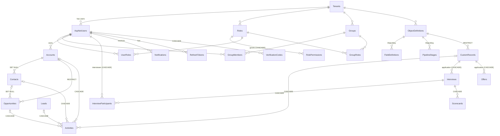

# CRM Platform: Data Model

PostgreSQL database **`CRM`**, schema `public`. The schema is created by these EF Core migrations:

| Migration | Contents |
|---|---|
| `20260930041532_InitialCreate` | v1: Identity tables, accounts, contacts, leads, opportunities, activities, refresh tokens |
| `20260930080943_MultiTenantPlatform` | v2: tenants, RBAC, metadata, custom records, automation, notifications and audit. Adds `TenantId` and `CustomFields` to existing tables and **migrates v1 data** (see below). |
| `20260930112016_SelfRegistration` | `Tenants.SelfRegistrationEnabled` (default false), `AspNetUsers.RegistrationStatus` (existing users default to `Approved`), `AppSettings`, `VerificationCodes` |
| `*_Phase0FilesAndPasswordReset` | New tables `Attachments` and `PasswordResetTokens` only; no changes to existing data |
| `20261001050127_Phase1RecruitmentCore` | `Tenants.TemplateVersion` (existing tenants default to 1) and `FieldDefinitions.IsUnique` (default false). No data changes; the recruitment template upgrade then runs at startup (see section 6). |
| `20261001061040_Phase2EmailAndScheduling` | New tables `EmailTemplates`, `OutboundEmails`, `ScheduledRuleRuns`; `AutomationRules.ScheduleField` and `ScheduleOffsetMinutes` (default 0). No data changes; recruitment tenants then get template v3 at startup. |
| `20261001071143_Phase3CareersAndExport` | `Tenants.CareersEnabled` (default false) and `Tenants.CareersIntro`. No data changes; recruitment tenants then get template v4 at startup. |
| `20261001081829_Phase4InterviewsAndAnalytics` | New tables `Interviews`, `InterviewParticipants`, `Scorecards`. No changes to existing tables; recruitment tenants then get template v5 at startup. |
| `20261001091146_Phase5OffersAndPrivacy` | New table `Offers`; `Tenants.CandidateRetentionMonths` (nullable, no policy by default). No data changes; recruitment tenants then get template v6 at startup. |
| `20261002023140_Phase6MockInterviews` | New table `MockInterviews`; `Tenants.MockAiReviewEnabled` (default false), `Tenants.MockAiTrigger` (default `Manual`), `Tenants.MockAiInstructions` (nullable); `AspNetUsers.ThemePreference` (default `System`). No data changes; recruitment tenants then get template v7 at startup. |

The equivalent idempotent DDL is [`backend/database/crm-schema.sql`](../backend/database/crm-schema.sql).

## 1. Overview



## 2. Tables

### 2.1 Tenancy and identity
| Table | Key columns | Notes |
|---|---|---|
| `Tenants` | `Id`, `Name`(200), `Slug`(64, **unique**), `Status` (Active/Suspended), `Currency`(3), `Template`(32), `TemplateVersion`, `SelfRegistrationEnabled`, `CareersEnabled`, `CareersIntro`(2000), `CandidateRetentionMonths`, `CreatedAt` | The default tenant is `0199a000-0000-7000-8000-000000000001` (slug `default`). The slug doubles as the **organisation code** for self-registration. |
| `AspNetUsers` | Identity columns + `TenantId` FK (RESTRICT), `FirstName`, `LastName`, `IsActive`, `IsPlatformAdmin`, **`RegistrationStatus`**(32), `CreatedAt` | Email is unique platform-wide. Users are never hard-deleted except when their tenant is deleted. `PhoneNumber` (E.164), `EmailConfirmed` and `PhoneNumberConfirmed` are set by self-registration. Index `(TenantId, RegistrationStatus)`. |
| `RefreshTokens` | `UserId` FK (CASCADE), `TokenHash`(128, **unique**), `ExpiresAt`, `RevokedAt` | SHA-256 of the token |
| `VerificationCodes` | `UserId` FK (CASCADE), `Channel` (Email/Sms), `CodeHash`(128), `CreatedAt`, `ExpiresAt`, `Attempts`, `ConsumedAt` | One-time codes. SHA-256 of `userId:channel:code`, never the code itself. Index `(UserId, Channel)`. |
| `PasswordResetTokens` | `UserId` FK (CASCADE), `TokenHash`(128, **unique**), `CreatedAt`, `ExpiresAt`, `ConsumedAt` | SHA-256 of the emailed 256-bit token. Issuing or using one consumes the user's other open tokens. |
| `AppSettings` | PK `Key`(100), `Value`(2000, JSON), `UpdatedAt` | **Global** (not tenant-owned) platform settings, one row per `PlatformSettings` property, e.g. `SelfRegistrationEnabled = true`. No secrets. |

### 2.2 Security
| Table | Key columns | Notes |
|---|---|---|
| `Roles` | `TenantId`, `Name`(100, unique per tenant), `Description`, `IsSystem`, `IsAdministrator` | Replaces `AspNetRoles` |
| `RolePermissions` | `RoleId` FK (CASCADE), `Resource`(40), `Action`(16), `Scope` | Unique `(RoleId, Resource, Action)`. `Scope = None` rows are explicit denies on specific objects. |
| `UserRoles` | PK `(UserId, RoleId)` | Direct assignments |
| `Groups` | `TenantId`, `Name`(100, unique per tenant), `Description` | |
| `GroupMembers` | PK `(GroupId, UserId)` | |
| `GroupRoles` | PK `(GroupId, RoleId)` | Roles inherited by members |

### 2.3 Metadata
| Table | Key columns | Notes |
|---|---|---|
| `ObjectDefinitions` | `TenantId`, `Key`(40, unique per tenant), `Label`, `PluralLabel`, `Icon`, `Description`, `NameLabel`, `IsStandard`, `IsActive`, `HasPipeline`, `SortOrder` | Standard keys: `account`, `contact`, `lead`, `opportunity`, `activity` |
| `FieldDefinitions` | `TenantId`, `ObjectKey`, `Key` (unique per tenant + object), `Label`, `Type`, `IsRequired`, `IsUnique`, `Options` jsonb, `LookupObjectKey`, `MaxLength`, `Min`, `Max`, `HelpText`, `ShowInList`, `SortOrder` | `IsUnique`: no two records of the object may share a value (Text, Email, Phone, Url) |
| `PipelineStages` | `TenantId`, `ObjectKey`, `Key`(64, unique per tenant + object), `Label`, `Category` (Open/Won/Lost), `Probability`, `Color`, `SortOrder` | |
| `Picklists` | `TenantId`, `Key`(64, unique per tenant), `Options` jsonb | `account.industry`, `lead.source`; recruitment tenants also have `interview.criteria` (what scorecards rate) |

### 2.4 Business records
All have `Id`, `TenantId`, `OwnerId` (FK RESTRICT), **`CustomFields jsonb NOT NULL DEFAULT '{}'`**, `CreatedAt`, `UpdatedAt`, and an index on `(TenantId, OwnerId)`.

| Table | Columns (besides the common ones) | Indexes |
|---|---|---|
| `Accounts` | `Name`(200), `Industry`, `Website`, `Phone`, `Email`, address, `AnnualRevenue`, `EmployeeCount`, `Description` | `(TenantId, Name)` |
| `Contacts` | `FirstName`, `LastName`, `Email`, `Phone`, `Mobile`, `JobTitle`, `Department`, `Description`, `AccountId` (SET NULL) | `(TenantId, LastName)`, `Email` |
| `Leads` | name, `Company`, `Email`, `Phone`, `JobTitle`, **`Source` varchar(64)** (picklist value), `Status`, `EstimatedValue`, `Description`, `ConvertedAt`, converted FKs (SET NULL) | `(TenantId, Status)`, `Email` |
| `Opportunities` | `Name`, `AccountId` (RESTRICT), `ContactId` (SET NULL), `Amount`, **`Stage` varchar(64)** (stage key), `Probability`, `ExpectedCloseDate` date, `ClosedAt`, `LossReason`, `Description` | `(TenantId, Stage)`, `ExpectedCloseDate` |
| `Activities` | `Type`, `Subject`, `Description`, `DueAt`, `CompletedAt`, `Priority`, `AccountId`, `ContactId`, `LeadId`, `OpportunityId`, **`CustomRecordId`** (all CASCADE) | `(TenantId, DueAt)` |
| `CustomRecords` | `ObjectDefinitionId` (RESTRICT), `Name`(200), `Stage`(64), `ClosedAt` | `(TenantId, ObjectDefinitionId, Stage)`, `(TenantId, ObjectDefinitionId, Name)` |

### 2.5 Automation and governance
| Table | Key columns | Notes |
|---|---|---|
| `AutomationRules` | `TenantId`, `Name`, `ObjectKey`, `Trigger` (Created/Updated/StageChanged/DateReached), `Conditions` jsonb, `Actions` jsonb, `IsActive`, `RunCount`, `LastRunAt`, `ScheduleField`(80), `ScheduleOffsetMinutes` | Indexes `(TenantId, ObjectKey)`, `(Trigger, IsActive)` |
| `EmailTemplates` | `TenantId`, `Name`(200, unique per tenant), `ObjectKey`(40), `Subject`(300), `Body`(10000) | Referenced from rule actions by id (JSON), so deletion is blocked while used |
| `OutboundEmails` | `TenantId`, `To`(320), `ReplyTo`, `Subject`(300), `Body`(10000), `ObjectKey`, `RecordId`, `RecordName`, `RuleId`, `TemplateId`, `ActivityId`, `SentById`, `SentByName`, `Status` (Pending/Sent/Failed/Cancelled), `Attempts`, `NextAttemptAt`, `LockedUntil`, `LastError`(1000), `CreatedAt`, `SentAt` | The transactional outbox. Indexes `(Status, NextAttemptAt)` for the dispatcher (across tenants), `(TenantId, CreatedAt)`, `(TenantId, RuleId, RecordId)` |
| `ScheduledRuleRuns` | `TenantId`, `RuleId`, `RecordId`, `DueAt`, `RanAt`, `Matched` | **Unique `(RuleId, RecordId, DueAt)`**: each due date fires once, even with several API instances |
| `Notifications` | `TenantId`, `UserId`, `Title`(200), `Message`(1000), `Link`(300), `CreatedAt`, `ReadAt` | Index `(TenantId, UserId, ReadAt)` |
| `AuditLogs` | `TenantId`, `EntityType`(64, the object key), `EntityId`, `EntityName`, `Action` (Created/Updated/Deleted/Exported), `UserId`, `UserName`, `Timestamp`, `Changes` jsonb | Indexes `(TenantId, EntityId)`, `(TenantId, Timestamp)`. *Exported* rows have an empty `EntityId`, a count as `EntityName` and the filters in `Changes`. |
| `Attachments` | `TenantId`, `ObjectKey`(40), `RecordId`, `FileName`(255), `ContentType`(100), `Size`, `StorageKey`(200), `UploadedById`, `UploadedByName`, `CreatedAt` | Index `(TenantId, ObjectKey, RecordId)`. The bytes live in file storage under `StorageKey` (`<tenant>/<yyyyMM>/<id>`). Rows are removed with their record. |

### 2.6 Interviews
| Table | Key columns | Notes |
|---|---|---|
| `Interviews` | `TenantId`, `ApplicationId` FK to `CustomRecords` (CASCADE), `ScheduledAt`, `DurationMinutes`, `Kind` (Phone/Video/Onsite), `Location`(500), `Notes`(2000), `Status` (Scheduled/Completed/Cancelled), `OrganizerId`, `CreatedAt`, `UpdatedAt` | Indexes `(TenantId, ApplicationId)`, `(TenantId, ScheduledAt)`. The application's `interview_date` field mirrors its next scheduled interview. |
| `InterviewParticipants` | PK `(InterviewId, UserId)`, both FK CASCADE; `ActivityId` | The interviewers. `ActivityId` is the *Meeting* activity on the interviewer's calendar (removed when they're taken off or the interview is cancelled). |
| `Scorecards` | `TenantId`, `InterviewId` FK (CASCADE), `InterviewerId`, `Recommendation` (StrongNo/No/Yes/StrongYes), `Ratings` jsonb, `Notes`(4000), `SubmittedAt` | **Unique `(InterviewId, InterviewerId)`**: one scorecard per interviewer; resubmitting replaces it. |
| `Offers` | `TenantId`, `ApplicationId` FK to `CustomRecords` (CASCADE), `Status` (Draft/Sent/Accepted/Declined/Withdrawn/Expired), `JobTitle`(200), `Salary` numeric(18,2), `Currency`(3), `PayPeriod` (Year/Month/Hour), `StartDate` date, `ExpiresAt`, `Letter`(20000), `Notes`(2000, internal), `CreatedById`, `TokenHash`(64), `SentAt`, `SentById`, `RespondedAt`, `SignedName`(200), `ResponseIp`(64), `ResponseUserAgent`(500), `DeclineReason`(2000) | **Unique `TokenHash`** (SHA-256 of the candidate's link token; the token itself is never stored). **Filtered unique `ApplicationId` where `Status IN ('Draft','Sent')`** (`IX_Offers_ApplicationId_Active`): at most one open offer per application, even under concurrent requests. Indexes `(TenantId, Status)`, `(TenantId, ApplicationId)`. `TokenHash` is never written to the audit log. |
| `MockInterviews` | `TenantId`, `ApplicationId` FK to `CustomRecords` (CASCADE), `Status` (Sent/InProgress/Submitted/Expired/Withdrawn), `JobTitle`(200), `Message`(2000), `Questions` jsonb (snapshot: `[{ id, prompt, details, competency, guidance, minutes }]`), `Answers` jsonb (`{ q1: { text, rating, seconds, answeredAt } }`), `ExpiresAt`, `TokenHash`(64), `SentById`, `SentAt`, `StartedAt`, `SubmittedAt`, `ReviewedById`, `ReviewedAt`, `ReadinessRating`, `ReviewNotes`(4000), `AiStatus` (NotRequested/Pending/Completed/Failed), `AiRequestedAt`, `AiReviewedAt`, `AiLockedUntil`, `AiModel`(100), `AiScore` numeric(3,1), `AiFeedback` jsonb (`{ summary, strengths[], improvements[], questions: [{ id, score, feedback }] }`), `AiError`(1000) | **Unique `TokenHash`**. **Filtered unique `ApplicationId` where `Status IN ('Sent','InProgress')`** (`IX_MockInterviews_ApplicationId_Open`). Indexes `(TenantId, ApplicationId)`, `(AiStatus, AiRequestedAt)` for the background reviewer. `Questions`, `Answers`, `AiFeedback`, `AiLockedUntil` and `TokenHash` are never written to the audit log. |

## 3. JSON columns

```jsonc
// Accounts.CustomFields: keys are FieldDefinitions.Key for the object
{ "tier": "Gold", "renewal_date": "2027-03-31", "vip": true, "regions": ["APAC", "EMEA"], "partner": "0199…(lookup id)" }

// AuditLogs.Changes (Updated): { field: [old, new] }. Custom fields appear as "cf.<key>".
{ "stage": ["Proposal", "ClosedWon"], "probability": [50, 100], "cf.tier": ["Silver", "Gold"] }

// AutomationRules.Conditions / Actions
[{ "field": "cf.priority", "operator": "Equals", "value": "Urgent" }]
[{ "type": "CreateTask", "subject": "Call {{name}}", "dueInDays": 1, "priority": "High", "assignTo": "owner" }]

// Scorecards.Ratings: criterion (from the interview.criteria picklist) → 1..5
{ "Skills": 4, "Communication": 5 }
```

Typed values in JSON: numbers are numbers (normalised, no trailing zeros), yes/no are booleans, dates are `yyyy-MM-dd`, date/times are ISO UTC, multi-picklists are arrays and lookups are record ids.

**Indexing custom fields at scale.** Filters use `jsonb @>` containment. For large tables add a GIN index, for example:
```sql
CREATE INDEX IF NOT EXISTS "IX_CustomRecords_CustomFields" ON "CustomRecords" USING gin ("CustomFields" jsonb_path_ops);
```

## 4. Conventions

| Topic | Rule |
|---|---|
| Primary keys | `uuid`, generated in the app as UUID v7 (time-ordered) |
| Tenancy | Every tenant-owned table has `TenantId uuid NOT NULL` (FK to `Tenants`). Composite indexes lead with `TenantId`. EF Core global query filters apply it to every query. |
| Timestamps | `timestamptz`, UTC. `CreatedAt` and `UpdatedAt` are set on save. |
| Money | `numeric(18,2)`. The tenant's currency applies to display only. |
| Enums | Stored as strings (e.g. `'Suspended'`, `'Group'`) |
| Deletes | Users are deactivated rather than deleted. Records with dependants use RESTRICT, and the API returns 409 with guidance. |

## 5. Enumerations

| Enum | Values |
|---|---|
| TenantStatus | Active, Suspended |
| RegistrationStatus | Approved, PendingVerification, PendingApproval, Rejected |
| VerificationChannel | Email, Sms |
| PermissionScope | None, Own, Group, All |
| FieldType | Text, TextArea, Number, Currency, Date, DateTime, Boolean, Picklist, MultiPicklist, Email, Phone, Url, Lookup |
| StageCategory | Open, Won, Lost |
| AutomationTrigger | Created, Updated, StageChanged, DateReached |
| ConditionOperator | Equals, NotEquals, GreaterThan, LessThan, Contains, IsEmpty, IsNotEmpty, Changed |
| AutomationActionType | CreateTask, Notify, SetField, SendEmail |
| AuditAction | Created, Updated, Deleted, Exported, Erased |
| InterviewKind / InterviewStatus | Phone, Video, Onsite / Scheduled, Completed, Cancelled |
| Recommendation | StrongNo, No, Yes, StrongYes |
| OfferStatus / PayPeriod | Draft, Sent, Accepted, Declined, Withdrawn, Expired / Year, Month, Hour |
| MockInterviewStatus / AiReviewStatus | Sent, InProgress, Submitted, Expired, Withdrawn / NotRequested, Pending, Completed, Failed |
| AiReviewTrigger / ThemePreference | Manual, OnSubmit / System, Light, Dark |
| LeadStatus | New, Contacted, Qualified, Unqualified, Converted |
| ActivityType / ActivityPriority | Task, Call, Meeting, Email, Note / Low, Normal, High |

Lead sources and opportunity stages are **no longer enums**. They're tenant data (picklist and pipeline stages).

## 6. v1 → v2 data migration

`MultiTenantPlatform` is hand-edited to keep existing data:
1. Inserts the **Default** tenant (`…000000000001`, slug `default`, currency AUD, template `sales`), and defaults every new `TenantId` column to it, so every existing row belongs to it.
2. Creates `Roles` with fixed ids and maps the v1 Identity roles:

   | v1 role | v2 role | Grants |
   |---|---|---|
   | Admin | Administrator (`…a001`) | Full access |
   | Manager | Manager (`…a002`) | `*` read, create, update and delete: All; users, groups, audit |
   | SalesRep | Standard User (`…a003`) | `*` read and create: All; update: Own |

   It then copies `AspNetUserRoles` into `UserRoles`.
3. v1 Admins become platform admins (`IsPlatformAdmin = true`).
4. Widens lead `Source` and opportunity `Stage` to `varchar(64)` so they can hold tenant-defined values. Existing values (e.g. `ClosedWon`, `ColdCall`) already match the sales template's stage keys and picklist.
5. Drops the Identity role tables (`AspNetRoles`, `AspNetUserRoles`, `AspNetRoleClaims`).

At startup, `DbInitializer` applies the sales template to the default tenant if it has no objects yet (objects, stages, picklists, fields, rules). It also makes sure the default roles exist with their grants; the migration creates the roles, and startup adds the grants shown above.

**Template upgrades.** Finally, `DbInitializer` upgrades any tenant whose `TemplateVersion` is below its template's current version, then saves the new version. Upgrades only add what is missing. The Recruitment template is at **v2**, which adds:
- the **Candidate** object (email unique, phone, location, current title and company, skills, source, LinkedIn, expected salary, notice period, summary);
- job opening fields (employment type, closing date, description);
- application fields (**candidate** lookup, source, rating, interview date, feedback);
- a "Rejection follow-up" rule.

On upgraded tenants, the application's candidate link is optional, so existing applications without one stay valid, and their old email and phone fields remain.

Recruitment **v3** adds four email templates (*Application received*, *Interview invitation*, *Application outcome*, *Job offer*) and four rules: *Interview reminder* (notify the owner a day before the interview, on), *Chase stalled applications* (task 7 days after the last update, off), and *Acknowledge new applications* and *Email rejected candidates* (email the candidate, **off** until an admin reviews the wording).

Recruitment **v4** adds the careers page fields: *Show on careers page* (`position.publish`, yes/no), *Cover note* (`application.cover_note`) and *Privacy consent* (`candidate.privacy_consent`, date/time). Upgraded tenants start with no job published and the careers page off.

Recruitment **v5** adds the `interview.criteria` picklist (*Skills*, *Experience*, *Communication*, *Problem solving*, *Culture fit*) used by interview scorecards. Administrators can change it under **Settings → Picklists**; existing scorecards keep their ratings.

Recruitment **v6** adds two application email templates: *Offer letter* (the default letter for new offers) and *Offer email* (sent with the candidate's link). Both can use the offer placeholders `{{offer.job_title}}`, `{{offer.salary}}`, `{{offer.start_date}}`, `{{offer.expires}}` and, in the offer email, `{{offer.link}}`.

Recruitment **v7** adds the *Practice questions* object (`mock_question`: name = the question; fields `competency` picklist, `position` lookup to job openings, `minutes`, `details`, `guidance`, `retired`) and the *Mock interview invitation* email template with `{{mock.job_title}}`, `{{mock.questions}}`, `{{mock.expires}}` and `{{mock.link}}`. The library starts empty in upgraded tenants; **Add starter questions** fills it.

## 6a. Erasure and the audit log

Erasing a candidate (on request or by the retention policy) deletes the candidate, their applications and everything that cascades from them (interviews, participants, scorecards, offers, mock interviews, activities, attachments and stored files), their outbound emails (by record or address) and notifications linking to them. Audit rows for all of those ids keep their action, user and time but get `EntityName = '[erased]'` and `Changes = '{}'`. One `Erased` row (no personal data) records the reason and counts.

## 7. Schema changes

```powershell
cd backend
dotnet ef migrations add <Name> --project src/Crm.Api --output-dir Data/Migrations
dotnet ef migrations script --idempotent --project src/Crm.Api --output database/crm-schema.sql
```
New tenant-owned entities must implement `ITenantEntity`; the global query filter and save guard then apply automatically.
