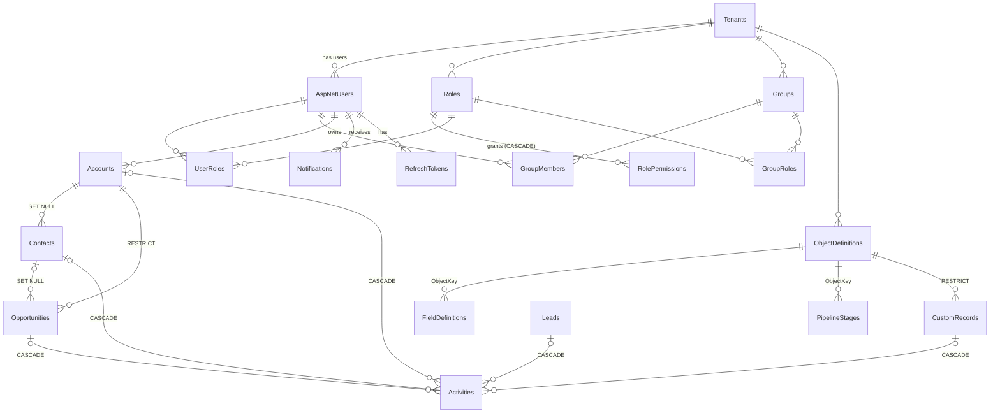

# CRM Platform: Data Model

PostgreSQL database **`CRM`**, schema `public`. The schema is created by two EF Core migrations:

| Migration | Contents |
|---|---|
| `20260930041532_InitialCreate` | v1: Identity tables, accounts, contacts, leads, opportunities, activities, refresh tokens |
| `20260930080943_MultiTenantPlatform` | v2: tenants, RBAC, metadata, custom records, automation, notifications and audit. Adds `TenantId` and `CustomFields` to existing tables and **migrates v1 data** (see below). |

The equivalent idempotent DDL is [`backend/database/crm-schema.sql`](../backend/database/crm-schema.sql).

## 1. Overview



## 2. Tables

### 2.1 Tenancy and identity
| Table | Key columns | Notes |
|---|---|---|
| `Tenants` | `Id`, `Name`(200), `Slug`(64, **unique**), `Status` (Active/Suspended), `Currency`(3), `Template`(32), `CreatedAt` | The default tenant is `0199a000-0000-7000-8000-000000000001` (slug `default`) |
| `AspNetUsers` | Identity columns + `TenantId` FK (RESTRICT), `FirstName`, `LastName`, `IsActive`, `IsPlatformAdmin`, `CreatedAt` | Email is unique platform-wide. Users are never hard-deleted except when their tenant is deleted. |
| `RefreshTokens` | `UserId` FK (CASCADE), `TokenHash`(128, **unique**), `ExpiresAt`, `RevokedAt` | SHA-256 of the token |

### 2.2 Security
| Table | Key columns | Notes |
|---|---|---|
| `Roles` | `TenantId`, `Name`(100, unique per tenant), `Description`, `IsSystem`, `IsAdministrator` | Replaces `AspNetRoles` |
| `RolePermissions` | `RoleId` FK (CASCADE), `Resource`(40), `Action`(16), `Scope` | Unique `(RoleId, Resource, Action)`. `Scope = None` rows are explicit denies on specific objects. |
| `UserRoles` | PK `(UserId, RoleId)` | Direct assignments |
| `Groups` | `TenantId`, `Name`(100, unique per tenant), `Description` | |
| `GroupMembers` | PK `(GroupId, UserId)` | |
| `GroupRoles` | PK `(GroupId, RoleId)` | Roles inherited by members |

### 2.3 Metadata
| Table | Key columns | Notes |
|---|---|---|
| `ObjectDefinitions` | `TenantId`, `Key`(40, unique per tenant), `Label`, `PluralLabel`, `Icon`, `Description`, `NameLabel`, `IsStandard`, `IsActive`, `HasPipeline`, `SortOrder` | Standard keys: `account`, `contact`, `lead`, `opportunity`, `activity` |
| `FieldDefinitions` | `TenantId`, `ObjectKey`, `Key` (unique per tenant + object), `Label`, `Type`, `IsRequired`, `Options` jsonb, `LookupObjectKey`, `MaxLength`, `Min`, `Max`, `HelpText`, `ShowInList`, `SortOrder` | |
| `PipelineStages` | `TenantId`, `ObjectKey`, `Key`(64, unique per tenant + object), `Label`, `Category` (Open/Won/Lost), `Probability`, `Color`, `SortOrder` | |
| `Picklists` | `TenantId`, `Key`(64, unique per tenant), `Options` jsonb | `account.industry`, `lead.source` |

### 2.4 Business records
All have `Id`, `TenantId`, `OwnerId` (FK RESTRICT), **`CustomFields jsonb NOT NULL DEFAULT '{}'`**, `CreatedAt`, `UpdatedAt`, and an index on `(TenantId, OwnerId)`.

| Table | Columns (besides the common ones) | Indexes |
|---|---|---|
| `Accounts` | `Name`(200), `Industry`, `Website`, `Phone`, `Email`, address, `AnnualRevenue`, `EmployeeCount`, `Description` | `(TenantId, Name)` |
| `Contacts` | `FirstName`, `LastName`, `Email`, `Phone`, `Mobile`, `JobTitle`, `Department`, `Description`, `AccountId` (SET NULL) | `(TenantId, LastName)`, `Email` |
| `Leads` | name, `Company`, `Email`, `Phone`, `JobTitle`, **`Source` varchar(64)** (picklist value), `Status`, `EstimatedValue`, `Description`, `ConvertedAt`, converted FKs (SET NULL) | `(TenantId, Status)`, `Email` |
| `Opportunities` | `Name`, `AccountId` (RESTRICT), `ContactId` (SET NULL), `Amount`, **`Stage` varchar(64)** (stage key), `Probability`, `ExpectedCloseDate` date, `ClosedAt`, `LossReason`, `Description` | `(TenantId, Stage)`, `ExpectedCloseDate` |
| `Activities` | `Type`, `Subject`, `Description`, `DueAt`, `CompletedAt`, `Priority`, `AccountId`, `ContactId`, `LeadId`, `OpportunityId`, **`CustomRecordId`** (all CASCADE) | `(TenantId, DueAt)` |
| `CustomRecords` | `ObjectDefinitionId` (RESTRICT), `Name`(200), `Stage`(64), `ClosedAt` | `(TenantId, ObjectDefinitionId, Stage)`, `(TenantId, ObjectDefinitionId, Name)` |

### 2.5 Automation and governance
| Table | Key columns | Notes |
|---|---|---|
| `AutomationRules` | `TenantId`, `Name`, `ObjectKey`, `Trigger`, `Conditions` jsonb, `Actions` jsonb, `IsActive`, `RunCount`, `LastRunAt` | Index `(TenantId, ObjectKey)` |
| `Notifications` | `TenantId`, `UserId`, `Title`(200), `Message`(1000), `Link`(300), `CreatedAt`, `ReadAt` | Index `(TenantId, UserId, ReadAt)` |
| `AuditLogs` | `TenantId`, `EntityType`(64, the object key), `EntityId`, `EntityName`, `Action` (Created/Updated/Deleted), `UserId`, `UserName`, `Timestamp`, `Changes` jsonb | Indexes `(TenantId, EntityId)`, `(TenantId, Timestamp)` |

## 3. JSON columns

```jsonc
// Accounts.CustomFields: keys are FieldDefinitions.Key for the object
{ "tier": "Gold", "renewal_date": "2027-03-31", "vip": true, "regions": ["APAC", "EMEA"], "partner": "0199…(lookup id)" }

// AuditLogs.Changes (Updated): { field: [old, new] }. Custom fields appear as "cf.<key>".
{ "stage": ["Proposal", "ClosedWon"], "probability": [50, 100], "cf.tier": ["Silver", "Gold"] }

// AutomationRules.Conditions / Actions
[{ "field": "cf.priority", "operator": "Equals", "value": "Urgent" }]
[{ "type": "CreateTask", "subject": "Call {{name}}", "dueInDays": 1, "priority": "High", "assignTo": "owner" }]
```

Typed values in JSON: numbers are numbers (normalised, no trailing zeros), yes/no are booleans, dates are `yyyy-MM-dd`, date/times are ISO UTC, multi-picklists are arrays and lookups are record ids.

**Indexing custom fields at scale.** Filters use `jsonb @>` containment. For large tables add a GIN index, for example:
```sql
CREATE INDEX IF NOT EXISTS "IX_CustomRecords_CustomFields" ON "CustomRecords" USING gin ("CustomFields" jsonb_path_ops);
```

## 4. Conventions

| Topic | Rule |
|---|---|
| Primary keys | `uuid`, generated in the app as UUID v7 (time-ordered) |
| Tenancy | Every tenant-owned table has `TenantId uuid NOT NULL` (FK to `Tenants`). Composite indexes lead with `TenantId`. EF Core global query filters apply it to every query. |
| Timestamps | `timestamptz`, UTC. `CreatedAt` and `UpdatedAt` are set on save. |
| Money | `numeric(18,2)`. The tenant's currency applies to display only. |
| Enums | Stored as strings (e.g. `'Suspended'`, `'Group'`) |
| Deletes | Users are deactivated rather than deleted. Records with dependants use RESTRICT, and the API returns 409 with guidance. |

## 5. Enumerations

| Enum | Values |
|---|---|
| TenantStatus | Active, Suspended |
| PermissionScope | None, Own, Group, All |
| FieldType | Text, TextArea, Number, Currency, Date, DateTime, Boolean, Picklist, MultiPicklist, Email, Phone, Url, Lookup |
| StageCategory | Open, Won, Lost |
| AutomationTrigger | Created, Updated, StageChanged |
| ConditionOperator | Equals, NotEquals, GreaterThan, LessThan, Contains, IsEmpty, IsNotEmpty, Changed |
| AutomationActionType | CreateTask, Notify, SetField |
| AuditAction | Created, Updated, Deleted |
| LeadStatus | New, Contacted, Qualified, Unqualified, Converted |
| ActivityType / ActivityPriority | Task, Call, Meeting, Email, Note / Low, Normal, High |

Lead sources and opportunity stages are **no longer enums**. They're tenant data (picklist and pipeline stages).

## 6. v1 → v2 data migration

`MultiTenantPlatform` is hand-edited to keep existing data:
1. Inserts the **Default** tenant (`…000000000001`, slug `default`, currency AUD, template `sales`), and defaults every new `TenantId` column to it, so every existing row belongs to it.
2. Creates `Roles` with fixed ids and maps the v1 Identity roles:

   | v1 role | v2 role | Grants |
   |---|---|---|
   | Admin | Administrator (`…a001`) | Full access |
   | Manager | Manager (`…a002`) | `*` read, create, update and delete: All; users, groups, audit |
   | SalesRep | Standard User (`…a003`) | `*` read and create: All; update: Own |

   It then copies `AspNetUserRoles` into `UserRoles`.
3. v1 Admins become platform admins (`IsPlatformAdmin = true`).
4. Widens lead `Source` and opportunity `Stage` to `varchar(64)` so they can hold tenant-defined values. Existing values (e.g. `ClosedWon`, `ColdCall`) already match the sales template's stage keys and picklist.
5. Drops the Identity role tables (`AspNetRoles`, `AspNetUserRoles`, `AspNetRoleClaims`).

At startup, `DbInitializer` applies the sales template to the default tenant if it has no objects yet (objects, stages, picklists, fields, rules). It also makes sure the default roles exist with their grants; the migration creates the roles, and startup adds the grants shown above.

## 7. Schema changes

```powershell
cd backend
dotnet ef migrations add <Name> --project src/Crm.Api --output-dir Data/Migrations
dotnet ef migrations script --idempotent --project src/Crm.Api --output database/crm-schema.sql
```
New tenant-owned entities must implement `ITenantEntity`; the global query filter and save guard then apply automatically.
