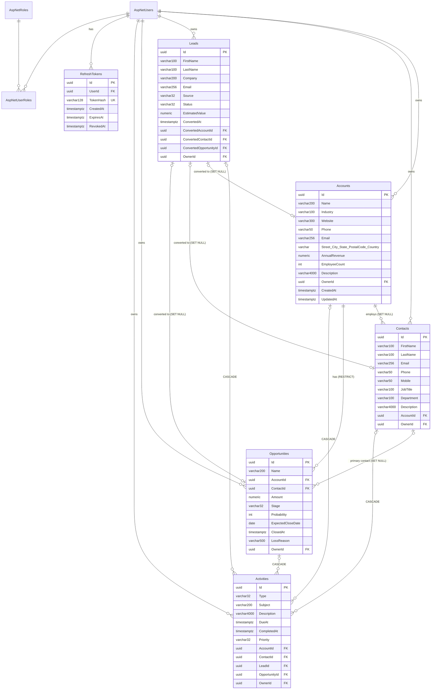

# CRM: Data Model

PostgreSQL schema `public`, database `crm`. Every table is created by the EF Core migration `InitialCreate`. The equivalent idempotent DDL is in [`backend/database/crm-schema.sql`](../backend/database/crm-schema.sql).

## Entity-relationship diagram



Every CRM table (Accounts, Contacts, Leads, Opportunities, Activities) has `Id`, `OwnerId`, `CreatedAt` and `UpdatedAt`.

## Conventions

| Topic | Rule |
|---|---|
| Primary keys | `uuid`, generated in the app as UUID v7 (time-ordered) |
| Timestamps | `timestamp with time zone`, always UTC. `CreatedAt` and `UpdatedAt` are set automatically on save. |
| Money | `numeric(18,2)` |
| Enums | Stored as `varchar(32)` strings, e.g. `'ClosedWon'` |
| Identity tables | Standard ASP.NET Core Identity (`AspNetUsers`, `AspNetRoles`, `AspNetUserRoles`, …). `AspNetUsers` adds `FirstName`, `LastName`, `IsActive`, `CreatedAt`. |
| Users | Never hard-deleted. Deactivate with `IsActive = false`. Owner FKs are `RESTRICT`. |

## Enumerations

| Enum | Values |
|---|---|
| LeadSource | Web, Referral, Event, ColdCall, Advertisement, Partner, Other |
| LeadStatus | New, Contacted, Qualified, Unqualified, Converted |
| OpportunityStage (default probability) | Prospecting (10), Qualification (25), Proposal (50), Negotiation (75), ClosedWon (100), ClosedLost (0) |
| ActivityType | Task, Call, Meeting, Email, Note |
| ActivityPriority | Low, Normal, High |
| Roles | Admin, Manager, SalesRep |

## Indexes

| Table | Index |
|---|---|
| Accounts | `Name`, `OwnerId` |
| Contacts | `LastName`, `Email`, `AccountId`, `OwnerId` |
| Leads | `Status`, `Email`, `OwnerId`, converted FKs |
| Opportunities | `Stage`, `ExpectedCloseDate`, `AccountId`, `ContactId`, `OwnerId` |
| Activities | `DueAt`, `OwnerId`, and every related FK |
| RefreshTokens | `TokenHash` (unique), `UserId` |

**Scaling note:** search uses `lower(col) LIKE '%term%'`. For more than about 1M rows, add `pg_trgm` GIN indexes, for example `CREATE INDEX ... USING gin (lower("Name") gin_trgm_ops)`.

## Schema changes

```powershell
cd backend
dotnet ef migrations add <Name> --project src/Crm.Api --output-dir Data/Migrations
dotnet ef migrations script --idempotent --project src/Crm.Api --output database/crm-schema.sql
```
